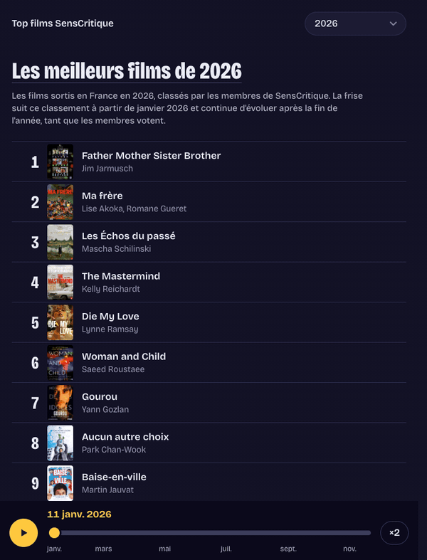

# SensCritique Top Movies

[](https://github.com/naei/senscritique-top-movies/commits/main/data)
[](LICENSE)

Replay how the best films of each year, and of all time, climbed and fell on [SensCritique](https://www.senscritique.com), week after week.

**[Open the timeline](https://naei.github.io/senscritique-top-movies/)**

> SensCritique is a French site: the page is in French and films appear under their French release titles.



## What you can do

- **Slide through time.** Pick a ranking, then drag the timeline or press play: the top 100 reorders itself as the weeks go by.
- **See who moved.** Each film shows the places it gained or lost since the previous snapshot, and whether it just entered the ranking.
- **Follow one film.** Click a film to see its best rank, when it entered the top, and its rank over time.
- **Watch a year settle.** Members keep voting after a year ends, so its ranking keeps moving. The timeline follows it to this day, with the part after the year hatched.
- **Go back over a decade.** The all-time top 100 can be replayed from 2013.

## How it works

- **A weekly snapshot.** Every Sunday, a GitHub Actions workflow runs `fetch.js`, which saves the current top 100 of each "Les meilleurs films de l'année" ranking and commits the result. The all-time "Top 100 des Tops 10 films" barely moves, so it is saved every four weeks.
- **New years add themselves.** When SensCritique opens the ranking of a new year, the script finds it and starts tracking it. The page picks it up on its own.
- **No build, no dependency.** The page is three static files (`index.html`, `style.css`, `app.js`) served by GitHub Pages.

## Data

| File | Content |
|---|---|
| `data/index.json` | The tracked rankings: one per year, plus the all-time top |
| `data/<year>.json`, `data/all-time.json` | The films of that ranking and, for each date, the film ids in ranking order |

Each snapshot is one line in its file, so a weekly update is a diff of a few lines.

Snapshots from before this project started tracking a ranking were rebuilt from Wayback Machine captures of its page. They are irregularly spaced and sometimes shorter than 100 films.

## Run locally

Requires Node.js 20 or later.

```
npm run fetch   # save today's rankings
npm start       # serve the page on http://127.0.0.1:8080
```

## License

Copyright (c) 2024 Lucas Pantanella. Released under the [MIT License](LICENSE).

This is an independent project, not affiliated with SensCritique. The rankings, film titles and posters belong to SensCritique and their respective rights holders.
